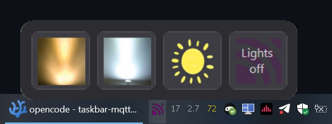
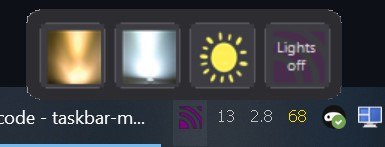
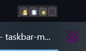
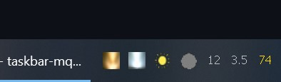

# Taskbar MQTT Client

A tiny portable tray app for Windows and Linux that lives in the notification area and publishes pre-configured MQTT messages at the click of a button. Configurable 1–9 buttons, each with its own topic, payload, QoS, retain flag and custom icon.

Two display modes are available:

**Popup-panel mode** — one tray icon, left-click to open a floating button panel. Its size is configurable from 25% to 200%.

 Shows 175%

 Shows 100%

 Shows 25%

**Multi-icon mode** — one tray icon per button, left-click to publish directly.



## Linux

The Linux edition (`taskbar-mqtt`) is built with .NET 9 and Avalonia. The tray icons are implemented directly on the freedesktop StatusNotifierItem protocol (via Tmds.DBus.Protocol), so they work with KDE Plasma, XFCE, Cinnamon, MATE, LXQt, Budgie, Unity, and GNOME with the AppIndicator extension. The popup panel opens right at the tray icon using the click coordinates the desktop passes with the Activate call. Settings are stored as XDG config, autostart uses `~/.config/autostart`, and notifications go through `notify-send`.

Left-click a tray icon to open the popup panel or publish; right-click shows the panel as well, with Settings and Quit buttons in its footer.

### Install a release binary

1. Download `taskbar-mqtt-linux-x64` from the [releases](../../releases) page.
2. `chmod +x taskbar-mqtt-linux-x64`
3. Put it in your `PATH` (for example `~/.local/bin`) and run it. The app starts silently in the notification area.
4. Right-click the tray icon and open **Settings…** to configure broker and buttons.
5. To autostart, tick **Launch on login** in the General tab (writes `~/.config/autostart/taskbar-mqtt.desktop`).

### Install from source

```bash
dotnet publish src/TaskbarMqtt.Linux/TaskbarMqtt.Linux.csproj -c Release -r linux-x64 \
    --self-contained true -p:PublishSingleFile=true -p:IncludeNativeLibrariesForSelfExtract=true \
    -o publish/linux-x64
./install.sh            # installs to ~/.local (no root needed); ./install.sh /usr for system-wide
./uninstall.sh          # remove again
```

The binary is self-contained — no .NET runtime installation is required. On Wayland sessions the app runs through XWayland so the popup panel can position itself next to the tray.

## Quick start (Windows)

1. Copy `dist\TaskbarMqtt_Setup_v1.9.0.exe` anywhere on your machine.
2. Run it. The app starts silently in the notification area (bottom-right of the taskbar).
3. Right-click the tray icon → **Settings…**.
4. Fill in the **Broker** tab (host, port, credentials, TLS) and click **Test connection** to verify.
5. In the **Buttons** tab, define up to 9 buttons — each with a label, MQTT topic, payload, QoS, retain, and an optional custom icon (PNG / JPG / ICO).
6. **OK** to save. `config.json` is written next to the executable (portable, no registry footprint except optional autostart).

## How to use

- **Popup-panel mode** (default): one tray icon. **Left-click** it to open a small floating panel with your buttons. Click a button to publish. The panel closes when it loses focus or the mouse leaves it.
- **Multi-icon mode**: one tray icon per button. **Left-click** an icon to publish directly.

Right-click any tray icon for:

- **Settings…** — open the configuration dialog
- **Quit** — exit the app

## Settings

### General


- **Display mode** — popup panel from one tray icon, or one tray icon per button
- **Popup size** — 25% to 200% in 25% steps; greyed out in multi-icon mode
- **Popup tooltips** — enable/disable and optionally show payload; greyed out in multi-icon mode
- **Popup stays open on click** — keep the popup visible after publishing
- **Custom tray icon** — optional path to `.ico`, `.png`, `.jpg`, `.bmp` for the main tray icon (popup mode)
- **Stretch, rounded corners, White→Transparent, Black→Transparent** — tray icon appearance options
- **Start with Windows** — toggle autostart via `HKCU\…\Run`

Settings are organized into grouped sections (MODE, POPUP, TRAY ICON, STARTUP). Popup-related controls are automatically greyed out when multi-icon mode is selected.

### Broker


- **Host / Port / Username / Password / Client ID / Keep-alive / Connection timeout**
- **Use TLS** — enables encrypted connection
- **Allow invalid / self-signed TLS certificates** — checked by default; uncheck to enforce certificate validation

Click **Test connection** in the Broker tab to verify settings before saving.

### Buttons (per row)


- **Description** — shown in tooltip / tray tooltip; falls back to the button's 1-based number when empty
- **Topic** — the MQTT topic to publish to (required)
- **Payload / QoS / Retain** — the message body, delivery guarantee (0 = at most once, 1 = at least once, 2 = exactly once), and whether the broker should keep the message for future subscribers
- **Icon** — optional path to `.ico`, `.png`, `.jpg`, `.bmp`. PNGs/JPGs are auto-resized to fit the tray and the popup button. When empty, the button number (1–9) is shown instead.
- **Stretch image** — when checked the icon fills the whole button; when unchecked it keeps its aspect ratio
- **White→Transparent / Black→Transparent** — per-button

Buttons are added and removed dynamically in the Buttons tab using the **+ Add Button** and **✕** buttons (minimum 1, maximum 9).

## Config file format

`config.json` is created on first launch and re-written on every **Apply** / **OK** in Settings. On Windows it lives next to `TaskbarMqtt.exe` (portable mode); when installed in `Program Files`, the app falls back to `%LOCALAPPDATA%\TaskbarMqtt\config.json` because the install directory is read-only. On Linux the config lives at `~/.config/TaskbarMqtt/config.json`; a `config.json` placed next to the binary is used instead (portable layout).

The file is hand-editable; changes take effect on next launch.

## Build from source (Windows)

Requirements: .NET SDK 9 (or 8) with NuGet. Restore assemblies for .NET Framework 4.8 are pulled in automatically via the `Microsoft.NETFramework.ReferenceAssemblies.net48` NuGet package.

```bash
dotnet build src/TaskbarMqtt/TaskbarMqtt.csproj -c Release
# Output: src/TaskbarMqtt/bin/Release/TaskbarMqtt.exe
```

The build embeds `MQTTnet` and `Newtonsoft.Json` into the .exe via Costura.Fody, so the final `TaskbarMqtt.exe` (~470 KB) runs on any Windows 10/11 machine without additional runtime installation. `.NET Framework 4.8` must be present (it ships with Windows 10/11 and is updated automatically).

## Project structure

```
src/TaskbarMqtt/            Windows edition (.NET Framework 4.8 WinForms)
  Program.cs            # Entry, single-instance mutex, message-only window for 2nd-instance
  App/
    TrayContext.cs      # ApplicationContext: owns NotifyIcons, popup, MQTT, context menu
    AutoStart.cs        # HKCU\…\Run helper
  Config/
    AppConfig.cs        # POCOs: BrokerSettings, ButtonConfig, AppConfig
    ConfigStore.cs      # JSON load/save next to .exe
  Mqtt/
    MqttService.cs      # MQTTnet v4 wrapper: connect, publish, auto-reconnect
  UI/
    PopupForm.cs        # Borderless hover panel
    SettingsForm.cs     # Tabbed settings dialog (General / Broker / Buttons)
  Assets/
    app.ico             # Tray icon (multi-resolution 16/32/48/64)
    button-default.ico  # Default button icon
src/TaskbarMqtt.Linux/      Linux edition (.NET 9, Avalonia; reuses Config/ and Mqtt/)
  Program.cs            # Entry, single-instance unix socket, X11 backend selection
  App/
    LinuxTrayContext.cs # Tray icons via StatusNotifierItem, popup, MQTT, tray menu
    AutoStart.cs        # XDG autostart .desktop helper
    ConfigStore.cs      # (shared, linked from TaskbarMqtt)
    ImageUtils.cs       # SkiaSharp: decode, transparency, resize, rounded corners
    PointerPosition.cs  # XQueryPointer for popup placement
    SingleInstance.cs   # Unix socket for 2nd-instance show requests
    SystemNotifications.cs # notify-send wrapper
    ThemeDetector.cs    # Dark mode via xdg-desktop-portal / gsettings / kdeglobals
  UI/
    PopupWindow.cs      # Borderless hover panel
    SettingsWindow.cs   # Tabbed settings dialog (General / Broker / Buttons / About)
  Assets/
    taskbar-mqtt.png    # App icon
```

## Regenerating the tray and button icons

Only needed if you want to modify the built-in `app.ico` (tray icon) or `button-default.ico` (default button icon). The source `.png` files and the generation script are in the repository root; run:

```powershell
powershell -ExecutionPolicy Bypass -File generate-icons.ps1
```

Produces multi-resolution `.ico` files (16/32/48/64) that are then embedded into the assembly at build time.

## License

MIT. Third-party: MQTTnet (MIT), Newtonsoft.Json (MIT), Costura.Fody (MIT).

## Version history

- **1.9.2** — Linux: tray icons re-implemented on a custom StatusNotifierItem service (Tmds.DBus.Protocol + source-generated handlers); the popup panel now opens exactly at the tray icon using the desktop-provided Activate coordinates (fixes misplaced popup on KDE Wayland); right-click opens the panel with Settings/Quit in its footer; multi-icon mode uses one bus name per icon.
- **1.9.1** — Linux edition: Avalonia-based port of the tray app (popup-panel and multi-icon modes, settings dialog, notifications, XDG autostart, single-instance via unix socket); `install.sh` / `uninstall.sh`; GitHub Actions workflow building Linux x64 and Windows binaries.
- **1.9.0** — Grouped General tab sections with grey-out logic; Retain moved to Payload line in button rows; popup image centering fixes; watermark scaling fix; rounded corners via SetClip approach; per-button StretchImage; aspect-ratio preserving icon display; custom tray icon preview.

---

**Keywords:** MQTT client, tray app, notification area, IoT button, home automation, smart home, MQTT publisher, taskbar, portable MQTT, dark mode, Linux, KDE, GNOME, XFCE, Avalonia, .NET Framework 4.8, WinForms, auto-reconnect, TLS support, custom icons, multi-icon tray.
